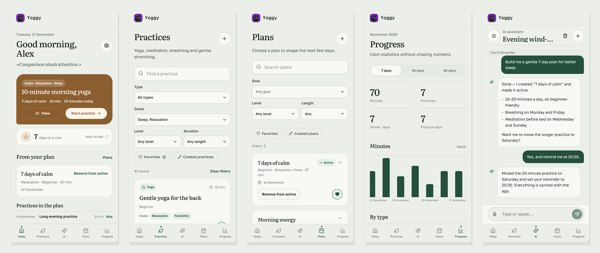
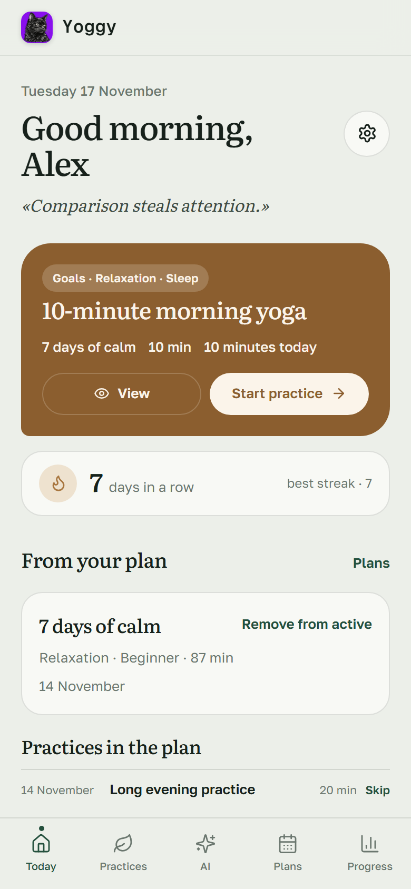
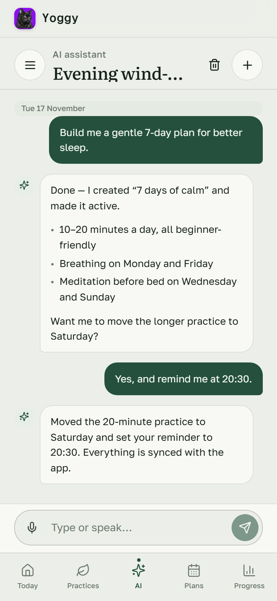
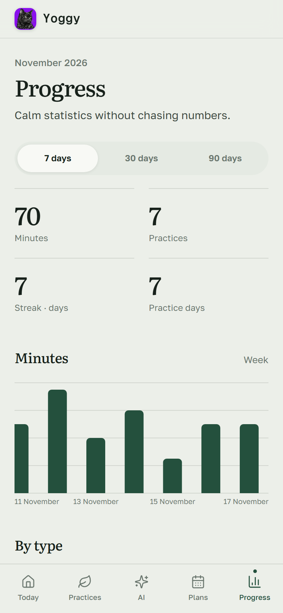
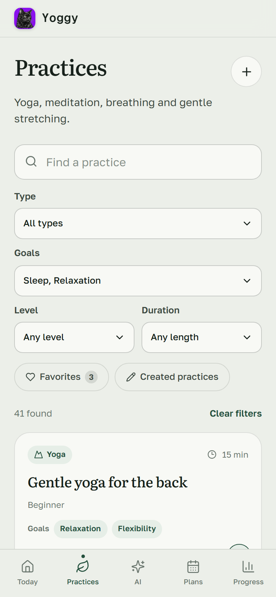
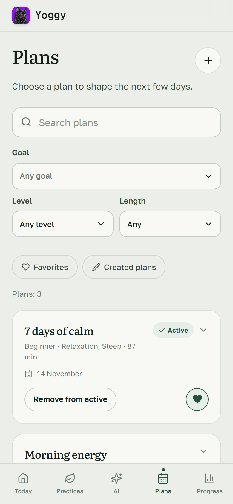
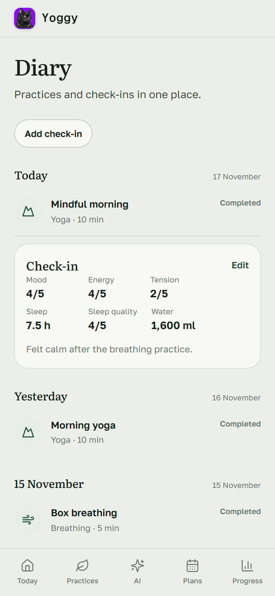

<p align="center">
  
</p>

<h1 align="center">Yoggy — yoga &amp; mindfulness in Telegram</h1>

<p align="center">
  <b>A calm coach for yoga, meditation and breathing — in the app you already have.<br>
  A weekly plan, a gentle diary and an AI assistant that listens.</b>
</p>

<p align="center">
  <a href="https://t.me/AiYoggyBot"><b>Open in Telegram</b></a>
  &nbsp;·&nbsp;
  <a href="https://ivanburenin.github.io/yoggy-ai/">Landing page</a>
</p>

<p align="center">
  
</p>

## What is Yoggy

Yoggy is a Telegram bot with a Mini App for people who want a steadier practice
without another subscription, another login or another noisy feed. It opens
right inside Telegram: nothing to install, no separate account.

Pick a practice for the day, keep a short weekly plan, record how you feel, and
watch the quiet progress. Or describe your week in plain words and let the AI
assistant shape the plan for you.

## What it does

### 🧘 Practices
- 65 guided practices: yoga, meditation, breathing and gentle stretching.
- Filters by type, goal, level and length — from 5 to 30 minutes.
- Step-by-step player with a breathing animation, background music and optional
  voice cues in six languages.
- Favorites and your own custom practices.

### 🗓 Plans
- 21 ready-made plans for calm, sleep, energy, focus and flexibility.
- A plan for the week with the right practice on each day.
- Choose one active plan, swap it or remove it — no pause semantics, no broken
  streaks.
- Create your own plan or ask the AI to build one.

### 🌿 Check-ins & diary
- Daily check-in: mood, energy, tension, sleep hours, sleep quality and water.
- A note for anything you want to remember.
- Sessions and check-ins in one diary, grouped by day.

### 📈 Progress
- Minutes practiced, sessions, practice days and streaks.
- Breakdown by practice type.
- Mood, energy and tension before and after.
- Week, month and 90-day views — calm statistics, no leaderboard.

### ✨ AI assistant
Describe what you need — “build me a gentle 7-day plan for better sleep” — and
the assistant creates it, activates it and moves practices when your week
changes. It can also log a session, save a check-in, update your profile and
answer questions about your progress.

- Shared history between the bot and the Mini App.
- Confirmation before anything is deleted.
- Undo for the last change.
- Voice input in the Mini App.

### 📱 Mini App
The same account and the same data, with a calmer interface: today’s practice,
the catalog, plans, the diary, progress and the AI chat. The bot sends
reminders; the Mini App opens with a button in the chat.

## Screens

| Today | AI assistant | Progress |
|:---:|:---:|:---:|
|  |  |  |
| **Practices** | **Plans** | **Diary** |
|  |  |  |

## Languages

The bot and the app speak six languages and follow your Telegram settings:

**English · Русский · Deutsch · Français · Español · 中文**

## Get started

1. Open the bot: **[t.me/AiYoggyBot](https://t.me/AiYoggyBot)**.
2. Tap **Start** — the bot asks a few gentle questions about your goal and
   experience.
3. Pick a practice for today, or ask the assistant to build a plan.

Everything stays in sync: start in the bot, continue in the app, and come back
whenever you like.

## FAQ

**Do I need to install anything?**
No. Yoggy lives in Telegram. The Mini App opens with a button in the chat and
works on iOS, Android, desktop and web.

**Is Yoggy free?**
Yes — you can start and keep a full practice with the free bot and Mini App.

**Where is my data stored?**
On Yoggy’s own servers. Your check-ins, notes and practice history are visible
only to you. You can export or delete your account from the profile.

**What if I miss a day?**
Nothing happens. There is no punishment and no broken-streak screen. The plan
waits for you.

**Is this medical advice?**
No. Yoggy offers general wellbeing practices. If you are pregnant, injured or
managing a condition, check with a professional before starting.

**Is the source code public?**
No. Yoggy is a product with a closed source. This repository hosts the public
landing page and product overview.

## How it’s built

- **Bot** — Python, aiogram 3, long polling.
- **Backend** — FastAPI, PostgreSQL, SQLAlchemy, Alembic, Alembic-managed schema.
- **Mini App** — React 18, TypeScript, Vite, custom CSS.
- **AI** — OpenCode Go (OpenAI-compatible inference) with backend tools,
  streaming and shared chat history.
- **Admin** — a Tracky-style FastAPI + Jinja2 panel with audit and 2FA.

## This repository

```
.
├── docs/               screenshots used by the README
├── landing/            React + Vite landing page (English)
│   ├── public/         app icon, screenshots, social preview
│   └── src/            page, styles
└── gh-pages            built landing (published by GitHub Pages)
```

The landing is published on GitHub Pages from the `gh-pages` branch:
**https://ivanburenin.github.io/yoggy-ai/**

### Run the landing locally

```bash
cd landing
npm install
npm run dev
```

Open `http://localhost:5174`.

### Publish

```bash
cd landing
npm run build -- --base=/yoggy-ai/
# copy landing/dist to the gh-pages branch and push
```

---

<p align="center">
  <a href="https://t.me/AiYoggyBot"><b>Open Yoggy in Telegram →</b></a>
</p>
